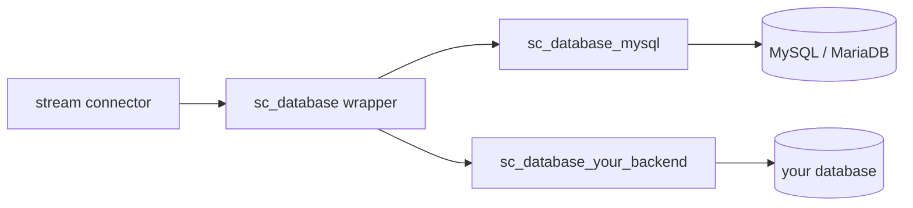

# How to write a database backend

- [How to write a database backend](#how-to-write-a-database-backend)
  - [Introduction](#introduction)
  - [Architecture](#architecture)
  - [Development guidelines](#development-guidelines)
    - [Name of your backend](#name-of-your-backend)
    - [Mandatory functions](#mandatory-functions)
    - [Connection handling](#connection-handling)
    - [Query results](#query-results)
    - [Escaping values](#escaping-values)
    - [Parameters](#parameters)
    - [Dependencies](#dependencies)
  - [Documentation](#documentation)

## Introduction

This guidelines documentation will explain how the stream connectors database system is working and how it communicates with the available backends.

Based on that, it will cover what a backend must do, how it should do it and what it could do.

Stream connectors sometimes need to query a database (to enrich events with data coming from a CMDB for example). Each database engine comes with its own Lua driver and its own way of doing things. The database backends hide those differences so that stream connectors always use the same methods whatever the database engine is.

Do not confuse database backends with [storage backends](how_to_write_a_storage_backend.md). Storage backends are used by stream connectors to store their own data. Database backends are used to run queries against a database that the stream connector does not own.

## Architecture



- a stream connector communicates with the sc_database wrapper. It is up to the sc_database wrapper to use the appropriate backend to run the queries.
- the backend is selected by the first parameter of the sc_database constructor (for example `sc_database.new("mysql", ...)` loads the sc_database_mysql backend). There is no default backend.
- a stream connector can create multiple instances of the sc_database wrapper, each one with its own backend and its own connection.

## Development guidelines

### Name of your backend

- Your backend Lua module must be created in the centreon-stream-connectors-lib/database_backends directory.
- Its name must be prefixed by **sc_database_**
- Its name must be unique.

For example : centreon-stream-connectors-lib/database_backends/sc_database_mysql.lua

The part that comes after **sc_database_** is the name of your backend. It is the name that must be given to the sc_database constructor (for example: "mysql").

### Mandatory functions

A database backend is a Lua module that must implement the following methods:

- .new(sc_common, sc_logger, params, db_params) (it is a module so it needs a constructor)
- execute(query)
- open_connection()
- close_connection()
- escape_nil()
- escape_string(value)
- escape_boolean(value)
- escape_number(value)

When implementing them in your database backend, you must follow the rules listed below:

- you need the exact same function parameter
- you need to return the exact same value.

The execute(), open_connection() and close_connection() methods are documented in the [sc_database documentation](../sc_database.md). The escape_* methods are described in the [Escaping values](#escaping-values) section below.

You can of course add your own methods (for example the mysql backend has a check_mandatory_params() and a build_result() method). They will only be used internally by your backend since the sc_database wrapper only calls the mandatory ones.

The escape_* methods are not called by stream connectors. They are called by the escape() method of the sc_database wrapper (see [Escaping values](#escaping-values)).

### Connection handling

- the constructor must not crash if the parameters are invalid. It must log the errors and the backend must refuse to connect until the parameters are fixed.
- the constructor doesn't have to open the connection. The connection must be opened by the execute() method if it is not already active.
- if a query fails, the connection may have been lost (database restart, network issue, timeout...). The execute() method should try to open the connection again and run the query one more time before giving up.
- the open_connection() and close_connection() methods must return false if they fail. They must never raise an error, even if close_connection() is called before any connection has been opened.

### Query results

The execute() method must always return the same kind of result, whatever the database engine is:

- `false` if something went wrong (the error must be logged)
- a table of rows if the query succeeded. Each row is a table indexed by column names
- an empty table if the query succeeded but has no result (an INSERT, UPDATE or DELETE query, or a SELECT query that doesn't match anything)

For example, the following query:

```sql
SELECT name, address FROM hosts;
```

must return:

```lua
{
  {
    name = "central",
    address = "127.0.0.1"
  },
  {
    name = "poller",
    address = "192.168.27.12"
  }
}
```

You absolutely must keep this consistent. A stream connector must be able to switch from one database backend to another without changing the way it reads the query results.

### Escaping values

Stream connectors escape the values they put in their queries using the [escape method](../sc_database.md#escape-method) of the sc_database wrapper. The wrapper handles everything that is the same for every database engine:

- it checks the type of the value and calls the appropriate escape_* method of your backend.
- it refuses unsupported types (tables, functions...) and returns false.
- it refuses NaN and infinite numbers and returns false.

Your backend only has to convert each type into the syntax of its database engine. Every escape_* method must return a string that can be used **as is** in a query. Stream connectors never add quotes around escaped values.

| method                | must return                                                                                          | MySQL        | PostgreSQL       | MSSQL         |
| --------------------- | ---------------------------------------------------------------------------------------------------- | ------------ | ---------------- | ------------- |
| escape_nil()          | the NULL keyword                                                                                     | `NULL`       | `NULL`           | `NULL`        |
| escape_string(value)  | the escaped string, quotes included                                                                  | `'O\'Brien'` | `'O''Brien'`     | `N'O''Brien'` |
| escape_boolean(value) | the boolean literal of the database engine                                                           | `1` / `0`    | `TRUE` / `FALSE` | `1` / `0`     |
| escape_number(value)  | the number without losing precision (integers with all their digits, floats with `%.14g` or `%.17g`) | `42`         | `42`             | `42`          |

When implementing them, you must follow the rules listed below:

- the methods must never raise an error. If something goes wrong, log the error and return false.
- escape_string() must use the escape function of the database driver when it exists (for example `conn:escape()` for luasql). It knows the charset of the connection and the configuration of the database server. If the connection is needed, open it if it is not already active.
- if the driver doesn't provide an escape function, double the single quotes (`'` becomes `''`). This is the SQL standard. **Never** write your own backslash based escaping: it only works with MySQL and is a common source of SQL injections with other database engines.
- escape_boolean() must use the boolean type of the database engine. For example, PostgreSQL has a real boolean type and refuses `1` and `0` for boolean columns, while MySQL, MSSQL and SQLite use `1` and `0`.
- escape_number() can trust the wrapper: it will never receive NaN or infinite numbers.

### Parameters

Each database backend can have its own set of parameters. To create them you must follow two rules:

- you need to add the parameter in the sc_params.lua Lua module under the `-- database parameters` part (this is for the sake of readability)
- it must use the following syntax `sc_database.<database_backend_name>.<param_name>` where:
  - <database_backend_name> must be the name of your database backend (for example for the sc_database_mysql backend it is everything that comes after sc_database_ therefore it is "mysql")
  - <param_name> is just your param name

For example, the mysql backend needs a parameter to know the name of the database. This parameter is named as follow:

sc_database.mysql.db_name

Your backend must also accept the same parameters through the db_params table given to the constructor, without the prefix (for example: `db_name`). Values from the db_params table always take precedence over the ones from the params table. This lets a stream connector open connections to multiple databases while using the stream connector parameters as default values.

### Dependencies

Database drivers are not installed with the stream connectors library. If your backend needs a Lua module (for example luasql.mysql for the mysql backend):

- load it with `pcall(require, "<module_name>")` and log an explicit error if it can't be loaded. Your backend must never crash the stream connector because a dependency is missing.
- explain how to install it in the Prerequisites section of your backend documentation.

## Documentation

Obviously the backend must be documented, even the functions that are already documented in the [database wrapper documentation](../sc_database.md).
The [sc_database_mysql documentation](../database_backends/sc_database_mysql.md) is a good example of how your database module must be documented.

You must also:

- add your backend in the list of available database backends in the [sc_database documentation](../sc_database.md#available-database-backends)
- add your functions in the global function index in the [README.md file](../README.md)
- add your parameters in the [sc_param documentation](../sc_param.md)
